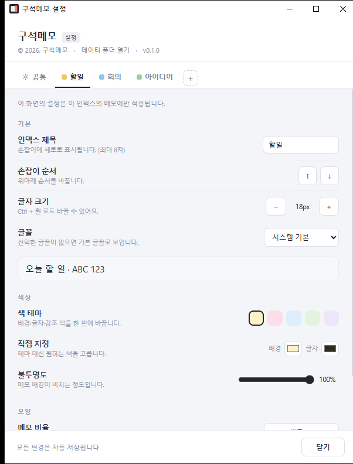

# 구석메모 (GuseokMemo)

화면 가장자리에 붙어 있는 작은 인덱스 손잡이를 누르면 메모가 **빼꼼** 나타나는,
사무실에서 가볍게 쓰는 Windows 메모 앱입니다.

- **Peekom(빼꼼 인덱스)** 의 기능을 모두 무료로 사용할 수 있도록 다시 만든 앱입니다.
- Electron 대신 **Tauri 2 + WebView2** 로 만들어 설치 파일이 가볍고 메모리 사용이 적습니다.
- 데이터는 PC 안에만 저장됩니다. 계정, 서버, 클라우드가 없습니다.

---




## 1. 주요 기능

### 가장자리 인덱스 손잡이
- 화면 오른쪽(또는 왼쪽) 가장자리에 인덱스 탭이 세로로 붙습니다.
- 탭을 **클릭**하면 메모가 열리고, 다시 클릭하면 닫힙니다.
- 탭을 **끌어서** 위아래 위치를 바꿀 수 있습니다. 놓으면 작업 영역 안쪽으로 자동 스냅됩니다.
- 탭 제목은 최대 8자, 색상은 인덱스마다 따로 지정합니다.
- 인덱스는 최대 **10개**까지 만들 수 있습니다.

### 빼꼼(PEEK) / 얼음(ICE)
- **빼꼼**: 마우스가 메모 밖으로 나가거나 다른 창을 누르면 잠시 뒤 자동으로 접힙니다.
- **얼음**: 메모를 화면에 고정합니다. 자동으로 접히지 않습니다.
- 메모 하단 왼쪽의 모드 칩을 눌러 전환합니다.

### 메모 편집
- 굵게 / 기울임 / 밑줄 / 취소선
- 정렬(왼쪽 → 가운데 → 오른쪽 순환)
- 글머리 기호, 번호 목록, **체크리스트**(완료 시 취소선 + 상태 저장)
- 이미지 넣기(메모당 최대 5장, 자동 축소 저장)
  - 이미지 비율: 1:1, 4:3, 3:4, 16:9
  - 이미지 크기: 50% ~ 150%
  - 선택 후 삭제
- 입력 중 자동 마크다운 변환 (Enter 로 확정)
  - `#`, `##`, `###` → 제목
  - `-` 또는 `*` → 글머리 기호
  - `1.` → 번호 목록
  - `- [ ]`, `- [x]` → 체크리스트
  - `**굵게**`, `*기울임*`, `~~취소선~~`
- 맞춤법 검사 켜기/끄기
- 글자 크기 10 ~ 40px (Ctrl + 마우스 휠)
- 글꼴 9종 (시스템, 맑은 고딕, 나눔고딕, 굴림, 돋움, 바탕, Arial, Georgia, Consolas)
- 메모 비율 6종 (1:1, 4:3, 3:2, 16:9, 3:4, 2:3)
- 배경 불투명도 25% ~ 100%

### 색상
- 기본 테마 5종: 크림, 핑크, 블루, 그린, 라벤더
- 배경색 / 글자색 직접 지정
- 강조 색은 테마에 맞춰 자동 적용

### 창과 모니터
- 표시 모니터: 자동(마우스가 있는 화면) 또는 특정 모니터 고정
- 표시 위치: 오른쪽 / 왼쪽 가장자리
- 자동 접힘 지연: 0.1초 ~ 1.5초

### 저장과 내보내기
- 모든 변경은 **자동 저장**됩니다. 하단에 "저장됨" 표시가 잠깐 나타납니다.
- 백업: 모든 인덱스를 JSON 파일 하나로 저장
- 복원: 백업 JSON 불러오기
- 내보내기: 현재 메모를 `.txt` 또는 `.md` 로 저장
- 데이터 폴더 열기

### 시작 프로그램
- Windows 시작 시 자동 실행 (HKCU Run 등록, 관리자 권한 불필요)

### 트레이
- 트레이 아이콘 왼쪽 클릭 → 설정
- 트레이 메뉴 → 설정 / 메모 열기·닫기 / 종료

---

## 2. 단축키

| 단축키 | 동작 |
|---|---|
| `Ctrl + Shift + M` | 메모 열기 / 닫기 (설정에서 변경 가능) |
| `Ctrl + Shift + ↑` | 이전 인덱스 |
| `Ctrl + Shift + ↓` | 다음 인덱스 |
| `Ctrl + 1` ~ `Ctrl + 9`, `Ctrl + 0` | 1~10번째 인덱스 바로 열기 (메모 창이 열려 있을 때) |
| `Ctrl + 마우스 휠` | 글자 크기 조절 |
| `Ctrl + S` | 즉시 저장 |
| `Esc` | 메모 닫기 |

열기 단축키는 설정 → 동작에서 `Ctrl+Shift+M`, `Ctrl+Alt+M`, `Ctrl+Shift+Space`, `F9` 중 고를 수 있습니다.

---

## 3. Peekom 기능 대조표

| 기능 | Peekom | 구석메모 |
|---|---|---|
| 가장자리 인덱스 손잡이 | 있음 | 있음 |
| 손잡이 드래그 이동 | Plus(슬롯별 위치) | 있음(공통 세로 위치, 자동 스냅) |
| 빼꼼 / 얼음 모드 | 있음 | 있음 |
| 인덱스 개수 | 무료 3개 / Plus 10개 | **10개 모두 무료** |
| 인덱스별 제목·색·글꼴·크기 | Plus 일부 | **전부 무료** |
| 투명도, 메모 비율 | Plus | **무료** |
| 리치 텍스트(굵게/기울임/밑줄/취소선/정렬) | 있음 | 있음 |
| 체크리스트 | 있음 | 있음(상태 저장) |
| 이미지 첨부 | Plus | **무료(5장)** |
| 자동 마크다운 | 있음 | 있음 |
| 맞춤법 검사 | 있음 | 있음 |
| 모니터 선택 / 좌우 위치 | Plus 일부 | **무료** |
| 자동 접힘 지연 | 있음 | 있음 |
| 전역 단축키 | 있음 | 있음 |
| 트레이 메뉴 | 있음 | 있음 |
| Windows 시작 시 실행 | 있음 | 있음 |
| JSON 백업 / 복원 | 있음 | 있음 |
| TXT / MD 내보내기 | 있음 | 있음 |
| 클라우드 동기화 | 없음(로컬) | 없음(로컬) |

> Peekom 의 유료(Plus) 기능에 해당하는 항목도 구석메모에서는 모두 무료로 열어 두었습니다.
> 라이선스 키, 로그인, 광고, 서버 통신이 없습니다.

---

## 4. 실행 방법

### 설치 파일
`src-tauri/target/release/bundle/nsis/GuseokMemo_0.1.0_x64-setup.exe`  (약 1.2 MB) 를 실행합니다.
현재 사용자 계정에만 설치되며 관리자 권한이 필요 없습니다.

### 설치된 앱
```
C:\Users\<사용자>\AppData\Local\GuseokMemo\guseok-memo.exe
```

### 포터블 실행
`src-tauri/target/release/guseok-memo.exe` 를 바로 실행해도 됩니다.
(Windows 10/11 기본 포함된 WebView2 Runtime 사용)

### 개발 실행
```powershell
npm install
npm run dev            # 프런트엔드만 (http://localhost:5183)
npx tauri dev          # 앱 전체
```

### 빌드
```powershell
npm run build          # dist/
npx tauri build        # NSIS 설치 파일 + exe
```

필요 환경:
- Windows 10/11
- Node.js 20+
- Rust (stable, `x86_64-pc-windows-msvc`)
- Visual Studio Build Tools (C++ 워크로드)
- WebView2 Runtime (Windows 11 기본 포함)

---

## 5. 데이터 위치

```
%APPDATA%\com.guseok.memo\store.json        현재 데이터
%APPDATA%\com.guseok.memo\store.bak.json    저장 직전 백업
```

- 저장은 임시 파일에 쓴 뒤 교체하는 방식이라, 저장 도중 앱이 꺼져도 파일이 깨질 가능성이 낮습니다.
- 설정 → 백업/복원에서 JSON 파일로 따로 보관할 수 있습니다.
- 앱을 지워도 이 폴더는 남습니다. 완전히 지우려면 위 폴더를 직접 삭제하세요.

---

## 6. 개인정보

- 네트워크 요청을 하지 않습니다. (업데이트 확인, 분석, 광고 없음)
- 메모와 설정은 위 로컬 파일에만 저장됩니다.
- 이미지는 원본이 아니라 JPEG 로 축소해 저장합니다.

---

## 7. 기술 구성

| 계층 | 사용 기술 |
|---|---|
| 앱 셸 | Tauri 2 (Rust) |
| 화면 | WebView2 + Vanilla JS + Vite |
| 저장 | JSON 파일 (Rust fs, 원자적 교체) |
| 전역 단축키 | tauri-plugin-global-shortcut |
| 트레이 | tauri tray-icon |
| 시작 프로그램 | winreg (HKCU\...\Run) |
| 모니터/작업 영역 | Win32 `MonitorFromPoint` + `GetMonitorInfoW` |

창 구성:
- `handles` : 40px 폭의 투명·항상 위·작업 표시줄 숨김 창
- `panel` : 메모 창(투명, 테두리 없음)
- `settings` : 일반 설정 창

---

## 8. 알려진 차이 / 의도한 단순화

- Peekom Plus 의 **슬롯별 손잡이 위치** 대신, 손잡이 전체의 세로 위치 하나를 공유합니다.
- 클라우드 동기화, 모바일 앱, 팀 공유는 제공하지 않습니다.
- 이미지 첨부는 5장까지이며, 원본 화질 그대로 보관하지 않습니다.
- 인덱스 색상은 테마 5종 + 직접 지정 방식입니다.

---

## 9. 분석 메모

Peekom 의 기능은 공개된 소개 페이지, 도움말, FAQ, 기능 비교표, 변경 이력, 설정 화면 캡처를 통해 정리했습니다.
`morluto/rea` 6.9.0 을 **우리 릴리스 번들 검증**에 실제 적용했습니다([docs/REA-NOTES.md](docs/REA-NOTES.md)). Peekom 유료 바이너리는 직접 뜯지 않고
공개 문서와 동작 관찰만으로 기능을 재구현했습니다([docs/PEEKOM-ANALYSIS.md](docs/PEEKOM-ANALYSIS.md)). (법적·윤리적 이유)

---

© 2026 구석메모 · Made for small offices.
---

## 10. 검증 기록 (2026-11-15)

앱 내 셀프테스트(`--selftest`) 결과 **18/18 PASS**:

| 테스트 | 내용 |
|---|---|
| markdown-h1 / bullet / checkbox | 자동 마크다운 변환 |
| checkbox-toggle / checked-parse / persist | 체크 상태·취소선 및 체크값 저장 |
| ck-enter-new-row / ck-backspace-unwrap | 체크리스트 안 Enter·Backspace |
| export-markdown | MD 내보내기 변환 |
| image-add / ratio / scale / delete | 이미지 추가·16:9·120%·삭제 |
| mode-ice / mode-peek | 빼꼼·얼음 모드 전환과 저장 |
| peek-autoclose | 빼꼼 모드에서 포커스 이탈 시 자동 닫힘 |
| ice-stays-open | 얼음 모드에서 닫히지 않음 |
| store-write / store-restore | 저장 및 원상 복구 |
| shortcuts | 전역 단축키 등록 |
| autostart (별도 QA) | HKCU Run 등록·기존값 복원 |

추가 확인:
- 메모 비율 16:9 설정 시 패널 창이 실제로 **1017×572** 로 확장됨
- 릴리스 exe·NSIS 설치본 모두 번들 UI 정상 렌더링
- 설치 파일 **1.19 MB**, 실행 파일 **3.39 MB**

REA(`morluto/rea` 6.9.0) 적용 기록은 [docs/REA-NOTES.md](docs/REA-NOTES.md) 에 있습니다.
(우리 릴리스 번들 11개 JS, 15,119 AST 노드, 파싱 실패 0 — Electron IPC 0은 Tauri라서 정상)