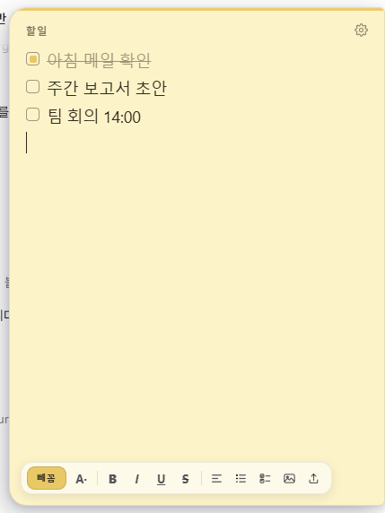

# 구석메모 (GuseokMemo)

화면 가장자리에 붙어 있는 작은 인덱스 손잡이를 누르면 메모가 **빼꼼** 나타나는,
사무실에서 가볍게 쓰는 Windows 메모 앱입니다.

- **Peekom(빼꼼 인덱스)** 의 기능을 모두 무료로 사용할 수 있도록 다시 만든 앱입니다.
- Electron 대신 **Tauri 2 + WebView2** 로 만들어 설치 파일이 가볍고 메모리 사용이 적습니다.
- 데이터는 PC 안에만 저장됩니다. 계정, 서버, 클라우드가 없습니다.
- **자동 업데이트**: GitHub Releases 를 확인해 새 버전을 자동으로 설치합니다.

저장소: https://github.com/Logic-k/GuseokMemo

---




## 1. 주요 기능

### 가장자리 인덱스 손잡이
- 화면 오른쪽(또는 왼쪽) 가장자리에 인덱스 탭이 세로로 붙습니다.
- 탭을 **클릭**하면 메모가 열리고, 다시 클릭하면 닫힙니다.
- 탭을 **끌어서** 위아래 위치를 바꿀 수 있습니다. 놓으면 작업 영역 안쪽으로 자동 스냅됩니다.
- 탭 제목은 최대 8자, 색상은 인덱스마다 따로 지정합니다.
- 인덱스는 최대 **10개**까지 만들 수 있으며, 설정에서 개별 인덱스를 **표시/숨김** 토글할 수 있습니다(데이터 보존, 마지막 1개 보호).

### 전체 검색 (v0.3)
- `Ctrl + Shift + F` 또는 패널 돋보기 버튼으로 독립 검색 창을 엽니다.
- 숨기지 않은 모든 인덱스의 제목·본문 텍스트를 실시간 검색하고, 매칭 스니펫을 굵게 표시합니다.
- `↑`/`↓` + `Enter` 또는 클릭으로 해당 메모로 바로 점프합니다.

### 리마인더 & 앱 내 토스트 (v0.3)
- 패널 헤더 시계 버튼에서 인덱스별 시각 리마인더를 예약합니다(없음 / 매일 / 매주 반복).
- 예약 시각이 되면 스트립 옆 앱 내 토스트로 알림이 뜨며, 클릭하면 해당 메모가 열립니다.
- 앱 재시작 후에도 예약이 유지되며, 지나간 예약은 설정 **리마인더** 탭에서 `놓침`으로 구분 표시됩니다.

### 템플릿 & 스니펫 (v0.3)
- 스트립 `+` 버튼 클릭 시 빈 메모 또는 저장된 템플릿을 골라 새 인덱스를 생성합니다.
- 패널 툴바 `❖` 버튼에서 자주 쓰는 스니펫을 커서 위치에 삽입합니다(`{{date}}`, `{{time}}` 치환 지원).
- 설정 **템플릿** 탭에서 템플릿·스니펫을 추가·삭제할 수 있습니다.

### 다크모드 (v0.3)
- 설정 **앱** 탭에서 라이트 / 다크 / 시스템 따르기를 선택합니다.
- 설정·검색·패널 툴바·팝오버·토스트 등 앱 크롬 전체에 적용되며, 개별 메모 카드의 배경·글자색 테마는 그대로 유지됩니다.

### 빼꼼(PEEK) / 얼음(ICE)
- **빼꼼**: 마우스가 메모 밖으로 나가거나 다른 창을 누르면 잠시 뒤 자동으로 접힙니다.
- **얼음**: 메모를 화면에 고정합니다. 자동으로 접히지 않습니다.
- 메모 하단 왼쪽의 모드 칩을 눌러 전환합니다.

### 메모 편집
- 굵게 / 기울임 / 밑줄 / 취소선
- 정렬(왼쪽 → 가운데 → 오른쪽 순환)
- 글머리 기호, 번호 목록, **체크리스트**(완료 시 취소선 + 상태 저장)
- 이미지 넣기(메모당 최대 5장, 자동 축소 저장)
  - 이미지 비율: 1:1, 4:3, 3:4, 16:9
  - 이미지 크기: 50% ~ 150%
  - 선택 후 삭제
- 입력 중 자동 마크다운 변환 (Enter 로 확정)
  - `#`, `##`, `###` → 제목
  - `-` 또는 `*` → 글머리 기호
  - `1.` → 번호 목록
  - `- [ ]`, `- [x]` → 체크리스트
  - `**굵게**`, `*기울임*`, `~~취소선~~`
- 맞춤법 검사 켜기/끄기
- 글자 크기 10 ~ 40px (Ctrl + 마우스 휠)
- 글꼴 9종 (시스템, 맑은 고딕, 나눔고딕, 굴림, 돋움, 바탕, Arial, Georgia, Consolas)
- 메모 비율 6종 (1:1, 4:3, 3:2, 16:9, 3:4, 2:3)
- 배경 불투명도 25% ~ 100%

### 색상
- 기본 테마 5종: 크림, 핑크, 블루, 그린, 라벤더
- 배경색 / 글자색 직접 지정
- 강조 색은 테마에 맞춰 자동 적용

### 창과 모니터
- 표시 모니터: 자동(마우스가 있는 화면) 또는 특정 모니터 고정
- 표시 위치: 오른쪽 / 왼쪽 가장자리
- 자동 접힘 지연: 0.1초 ~ 1.5초

### 저장·폴더 동기화·내보내기
- 모든 변경은 **자동 저장**됩니다(원자적 교체 + Windows 파일 점유 재시도). 하단에 "저장됨" 표시가 잠깐 나타납니다.
- **저장 폴더 지정 & 자동 리로드 (v0.3)**: 설정 **저장** 탭에서 OneDrive/Syncthing 폴더로 데이터 위치를 변경할 수 있습니다. 외부 변경을 자동 감지해 리로드하며, 미저장 편집과 충돌 시 로컬본을 `store.conflict-*.json`으로 별도 보관합니다.
- 백업: 모든 인덱스를 JSON 파일 하나로 저장
- 복원: 백업 JSON 불러오기
- 내보내기: 현재 메모를 `.txt` 또는 `.md` 로 저장
- 데이터 폴더 열기

### 시작 프로그램
- Windows 시작 시 자동 실행 (HKCU Run 등록, 관리자 권한 불필요)

### 트레이
- 트레이 아이콘 왼쪽 클릭 → 설정
- 트레이 메뉴 → 설정 / 메모 열기·닫기 / 종료

---

## 2. 단축키

| 단축키 | 동작 |
|---|---|
| `Ctrl + Shift + M` | 메모 열기 / 닫기 (설정에서 변경 가능) |
| `Ctrl + Shift + F` | 전체 검색 창 열기 (설정에서 변경 가능) |
| `Ctrl + Shift + ↑` | 이전 인덱스 |
| `Ctrl + Shift + ↓` | 다음 인덱스 |
| `Ctrl + 1` ~ `Ctrl + 9`, `Ctrl + 0` | 1~10번째 표시 인덱스 바로 열기 (메모 창이 열려 있을 때) |
| `Ctrl + 마우스 휠` | 글자 크기 조절 |
| `Ctrl + S` | 즉시 저장 |
| `Esc` | 팝오버 / 검색 창 / 메모 닫기 |

열기 단축키는 설정 → 동작에서 `Ctrl+Shift+M`, `Ctrl+Alt+M`, `Ctrl+Shift+Space`, `F9` 중 고를 수 있습니다.

---

## 3. Peekom 기능 대조표

| 기능 | Peekom | 구석메모 |
|---|---|---|
| 가장자리 인덱스 손잡이 | 있음 | 있음 |
| 손잡이 드래그 이동 | Plus(슬롯별 위치) | 있음(공통 세로 위치, 자동 스냅) |
| 빼꼼 / 얼음 모드 | 있음 | 있음 |
| 인덱스 개수 | 무료 3개 / Plus 10개 | **10개 모두 무료** |
| 인덱스별 제목·색·글꼴·크기 | Plus 일부 | **전부 무료** |
| 투명도, 메모 비율 | Plus | **무료** |
| 리치 텍스트(굵게/기울임/밑줄/취소선/정렬) | 있음 | 있음 |
| 체크리스트 | 있음 | 있음(상태 저장) |
| 이미지 첨부 | Plus | **무료(5장)** |
| 자동 마크다운 | 있음 | 있음 |
| 맞춤법 검사 | 있음 | 있음 |
| 모니터 선택 / 좌우 위치 | Plus 일부 | **무료** |
| 자동 접힘 지연 | 있음 | 있음 |
| 전역 단축키 | 있음 | 있음 |
| 트레이 메뉴 | 있음 | 있음 |
| Windows 시작 시 실행 | 있음 | 있음 |
| JSON 백업 / 복원 | 있음 | 있음 |
| TXT / MD 내보내기 | 있음 | 있음 |
| 클라우드 동기화 | 없음(로컬) | 없음(로컬) |

> Peekom 의 유료(Plus) 기능에 해당하는 항목도 구석메모에서는 모두 무료로 열어 두었습니다.
> 라이선스 키, 로그인, 광고, 서버 통신이 없습니다.

---

## 4. 실행 방법

### 설치 파일
[GitHub Releases](https://github.com/Logic-k/GuseokMemo/releases/latest) 에서 `GuseokMemo_*_x64-setup.exe` 를 내려받아 실행합니다.
현재 사용자 계정에만 설치되며 관리자 권한이 필요 없습니다.
로컬 빌드라면 `src-tauri/target/release/bundle/nsis/` 안에 있습니다.

### 자동 업데이트
앱을 실행하면 약 5초 뒤 GitHub Releases 의 `latest.json` 을 확인합니다.
새 버전이 있으면 자동으로 내려받아 설치하고 앱이 재시작됩니다.
설정 → **앱 → 업데이트 → 지금 확인** 으로 수동 확인도 가능합니다.
업데이트 패키지는 minisign 키로 서명되며, 개인 키는 저장소에 포함되지 않습니다
(`~/.tauri/guseok-memo.key`, CI 에는 `TAURI_SIGNING_PRIVATE_KEY` 시크릿).

### 설치된 앱
```
C:\Users\<사용자>\AppData\Local\GuseokMemo\guseok-memo.exe
```

### 포터블 실행
`src-tauri/target/release/guseok-memo.exe` 를 바로 실행해도 됩니다.
(Windows 10/11 기본 포함된 WebView2 Runtime 사용)

### 개발 실행
```powershell
npm install
npm run dev            # 프런트엔드만 (http://localhost:5183)
npx tauri dev          # 앱 전체
```

### 빌드
```powershell
npm run build          # dist/
npx tauri build        # NSIS 설치 파일 + exe
```

필요 환경:
- Windows 10/11
- Node.js 20+
- Rust (stable, `x86_64-pc-windows-msvc`)
- Visual Studio Build Tools (C++ 워크로드)
- WebView2 Runtime (Windows 11 기본 포함)

---

## 5. 데이터 위치

```
%APPDATA%\com.guseok.memo\store.json        현재 데이터
%APPDATA%\com.guseok.memo\store.bak.json    저장 직전 백업
```

- 저장은 임시 파일에 쓴 뒤 교체하는 방식이라, 저장 도중 앱이 꺼져도 파일이 깨질 가능성이 낮습니다.
- 설정 → 백업/복원에서 JSON 파일로 따로 보관할 수 있습니다.
- 앱을 지워도 이 폴더는 남습니다. 완전히 지우려면 위 폴더를 직접 삭제하세요.

---

## 6. 개인정보

- 메모와 설정은 위 로컬 파일에만 저장됩니다.
- 유일한 네트워크 요청은 **업데이트 확인**(GitHub Releases `latest.json` 조회)입니다.
  업데이트가 있을 때만 설치 파일을 내려받습니다. 분석, 광고, 텔레메트리는 없습니다.
- 이미지는 원본이 아니라 JPEG 로 축소해 저장합니다.

---

## 7. 기술 구성

| 계층 | 사용 기술 |
|---|---|
| 앱 셸 | Tauri 2 (Rust) |
| 화면 | WebView2 + Vanilla JS + Vite |
| 저장 | JSON 파일 (Rust fs, 원자적 교체) |
| 전역 단축키 | tauri-plugin-global-shortcut |
| 트레이 | tauri tray-icon |
| 시작 프로그램 | winreg (HKCU\...\Run) |
| 모니터/작업 영역 | Win32 `MonitorFromPoint` + `GetMonitorInfoW` |

창 구성 (모두 부팅 시 생성 후 show/hide 재사용):
- `handles` : 40px 폭의 투명·항상 위·작업 표시줄 숨김 스트립 창
- `panel` : 메모 카드 창(투명, 테두리 없음)
- `settings` : 일반 설정 창
- `search` : 전체 검색 창
- `toast` : 리마인더·충돌 알림 토스트 창 (event-only ACL)
- `pick` : 새 메모 템플릿 선택 창 (event-only ACL)

---

## 8. 알려진 차이 / 의도한 단순화

- Peekom Plus 의 **슬롯별 손잡이 위치** 대신, 손잡이 전체의 세로 위치 하나를 공유합니다.
- 클라우드 동기화, 모바일 앱, 팀 공유는 제공하지 않습니다.
- 이미지 첨부는 5장까지이며, 원본 화질 그대로 보관하지 않습니다.
- 인덱스 색상은 테마 5종 + 직접 지정 방식입니다.

---

## 9. 분석 메모

Peekom 의 기능은 공개된 소개 페이지, 도움말, FAQ, 기능 비교표, 변경 이력, 설정 화면 캡처를 통해 정리했습니다.
`morluto/rea` 6.9.0 을 **우리 릴리스 번들 검증**에 실제 적용했습니다([docs/REA-NOTES.md](docs/REA-NOTES.md)). Peekom 유료 바이너리는 직접 뜯지 않고
공개 문서와 동작 관찰만으로 기능을 재구현했습니다([docs/PEEKOM-ANALYSIS.md](docs/PEEKOM-ANALYSIS.md)). (법적·윤리적 이유)

---

© 2026 구석메모 · Made for small offices.
---

## 10. 검증 기록 (v0.3.1, 2026-11-19)

- Rust 단위 테스트(`cargo test`): **38/38 PASS** (저장 재시도·폴더 포인터·충돌본·리마인더 스케줄러·외부 감시·부팅 준비 핸드셰이크)
- 앱 내 셀프테스트(`--selftest`): **86/86 PASS** (마크다운·체크리스트·IME 가드·이미지·검색·리마인더·토스트·충돌본·다크모드·템플릿/스니펫·숨김·스키마 v1→v2 마이그레이션·다운그레이드 호환)
- 린트: `cargo fmt --check` + `cargo clippy --all-targets -- -D warnings` 경고 0
- CDP E2E: 검색·리마인더·토스트·충돌본·저장 탭·다크모드·템플릿/스니펫·숨김·IME 스위트 통과

REA(`morluto/rea` 6.9.0) 적용 기록은 [docs/REA-NOTES.md](docs/REA-NOTES.md) 에 있습니다.